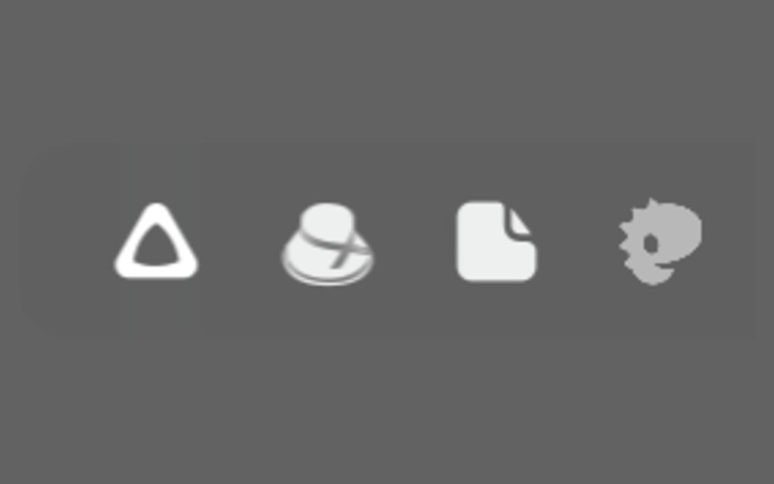
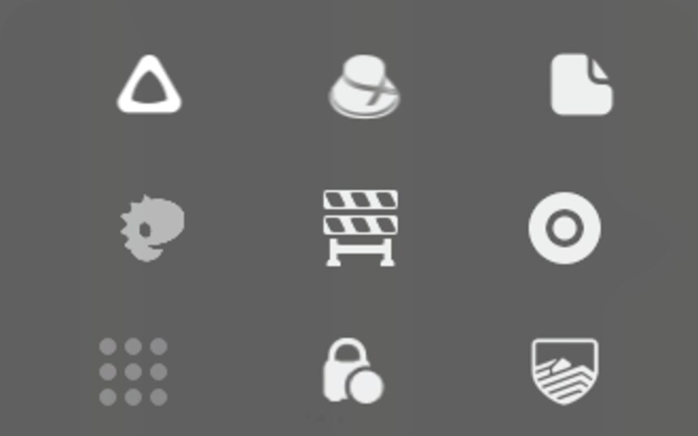
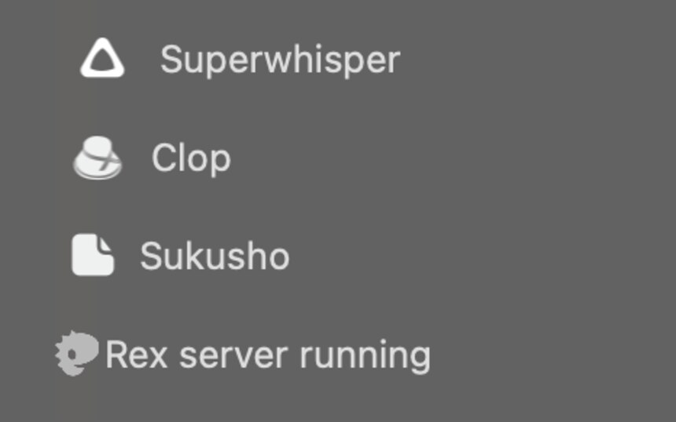

  <picture>
    <source media="(prefers-color-scheme: dark)" srcset="docs/wordmark-dark.svg">
    <source media="(prefers-color-scheme: light)" srcset="docs/wordmark-light.svg">
    
  </picture>

Hides the menu bar icons you don't need to see. Click the hot dog to get them back.

  <a href="https://github.com/tommyent/notahotdog/releases/latest"><strong>Download</strong></a> ·
  <a href="https://tommyent.github.io/notahotdog/"><strong>Website</strong></a> ·
  <a href="docs/features.md"><strong>All features</strong></a> ·
  <a href="docs/guide.md"><strong>Docs</strong></a>

## Three ways to see hidden icons

Click a picture to see it full size.

<table>
  <tr>
    <td width="33%" valign="top"> <b>Shelf</b> puts icons in a row below the menu bar.</td>
    <td width="33%" valign="top"> <b>Tray</b> keeps icons in a compact grid.</td>
    <td width="33%" valign="top"> <b>Index</b> lists icons with app names.</td>
  </tr>
</table>

## Install

1. [Download the DMG](https://github.com/tommyent/notahotdog/releases/latest) and open it.
2. Drag Not A Hot Dog to Applications and open it.

Tested on macOS 27.3 on Apple silicon. Updates arrive through [Sparkle](https://sparkle-project.org); **Check for Updates…** is in the right-click menu.

## Docs

[All features and setup](docs/features.md) · [Permissions, privacy, limits, uninstall and building](docs/guide.md) · [Release notes](docs/notes/NotAHotDog-1.0.0.md)

## Credits and licence

[MIT](LICENSE). Updates by [Sparkle](https://github.com/sparkle-project/Sparkle) (MIT). The name is set in [Barrio](https://fonts.google.com/specimen/Barrio) by Omnibus-Type, under the [SIL Open Font License 1.1](docs/Barrio-OFL.txt).
