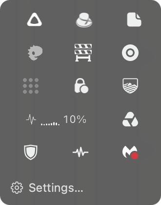
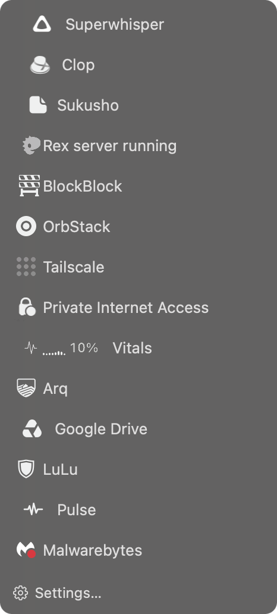

  <picture>
    <source media="(prefers-color-scheme: dark)" srcset="docs/wordmark-dark.svg">
    <source media="(prefers-color-scheme: light)" srcset="docs/wordmark-light.svg">
    
  </picture>

Hides the menu bar icons you don't need to see. Click the hot dog to get them back.

 <b>Shelf</b>

<table align="center">
  <tr>
    <td align="center" valign="top"> <b>Tray</b></td>
    <td align="center" valign="top"> <b>Index</b></td>
  </tr>
</table>

## Install

Download the DMG from [Releases](https://github.com/tommyent/notahotdog/releases/latest), open it and drag Not A Hot Dog to Applications. Updates arrive through [Sparkle](https://sparkle-project.org): the app asks once whether to check by itself, and **Check for Updates…** is in its menu.

Needs macOS 27.3 or later (in beta as of November 2026) on an Apple silicon Mac.

## Use

- Right-click the hot dog and choose **Arrange Icons**. ⌘-drag the icons you don't need to the left of **Done**, then click **Done**.
- Click the hot dog to see the hidden icons, and click one to use it.
- Right-click the hot dog for the panel style (Shelf, Tray or Index), Launch at Login, updates and Quit.

## Permissions

| Permission | Why | Without it |
| --- | --- | --- |
| Accessibility (macOS 27 calls it "Device Control and Data Access") | Finds the menu bar icons and clicks the one you pick. | Nothing is hidden; every icon stays in the menu bar. |
| Screen Recording (optional) | Photographs each icon in the menu bar, so the panel shows it as it really looks. Nothing is recorded or saved. | The panel shows app icons instead. |

The app asks for neither by itself: both are items in its right-click menu.

For Screen Recording, choose **Allow Screen Recording (optional, shows real icons)…** in that menu. System Settings opens with Not A Hot Dog in the Screen & System Audio Recording list. Turn its switch on and the app restarts. macOS then asks once whether the app may "bypass the system private window picker and directly access your screen and audio": click **Allow**. *(Observed on macOS 27.0.1 with a test build of 1.0.0.)*

## Privacy

No analytics and no accounts. The only network use is Sparkle's update check, which fetches the feed at `tommyent.github.io/notahotdog/appcast.xml`. Sparkle asks for permission before it checks automatically, on the second launch (from Sparkle's source and documentation; not yet observed in this app). Debug logging is off unless you turn it on.

## How it works, and its limits

macOS 27 draws the whole menu bar as one window, so an app can no longer push other apps' icons off the screen. Not A Hot Dog instead asks the menu bar to show only an allowed list of apps, through a private macOS interface (`MenuBarClientCore`). That has consequences:

- Hiding is per app, not per icon: an app with two icons shows or hides both.
- A hidden icon comes back into the menu bar for as long as you use it, then hides again.
- The interface is private, so a macOS update can break it. If it's missing, the icons simply stay visible.
- Quitting the app brings every icon back.

## Uninstall

1. Right-click the hot dog and turn off **Launch at Login**, then choose **Quit**. Your icons come back.
2. Move Not A Hot Dog from Applications to the Trash.
3. Optional: remove it from System Settings › Privacy & Security (Accessibility, Screen Recording), and run `defaults delete com.tommyent.notahotdog` in Terminal to remove its settings.

*The "Without it" column of the permissions table, the limits and the uninstall steps above describe what the source does; they have not yet been re-checked on a clean Mac with this release.*

## Build

`./build.sh` builds and signs `build.noindex/Not A Hot Dog.app` (built with Xcode 27.2; it needs a Developer ID certificate). `scripts/release.sh` makes the notarized DMG and the update feed.

## Licence and credits

[MIT](LICENSE). Updates by [Sparkle](https://github.com/sparkle-project/Sparkle) (MIT). The name is set in [Barrio](https://fonts.google.com/specimen/Barrio) by Omnibus-Type, under the [SIL Open Font License 1.1](docs/Barrio-OFL.txt).
