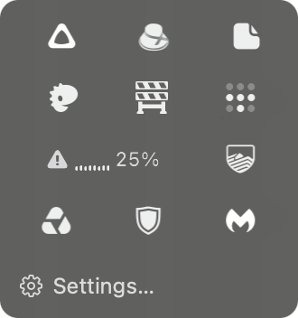
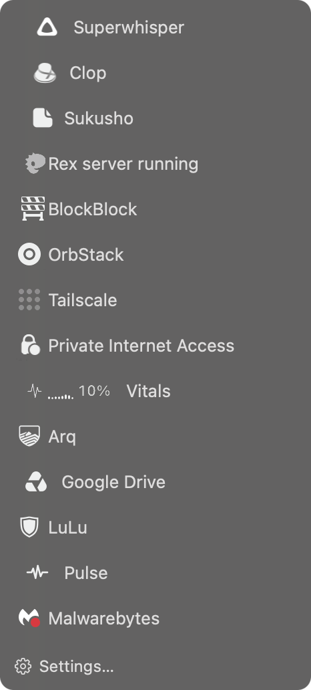

# Features and setup

## Shelf

Shelf shows hidden icons in a row under the menu bar.

## Tray

Tray shows hidden icons in a compact grid.

## Index

Index lists hidden icons with each app's name.

## Use

- Right-click the hot dog and choose **Arrange Icons**. ⌘-drag the icons you don't need to the left of **Done**, then click **Done**.
- Click the hot dog to see the hidden icons, and click one to use it.
- Right-click the hot dog for the panel style (Shelf, Tray or Index), Launch at Login, updates and Quit.

[Permissions, privacy and limits →](guide.md)
